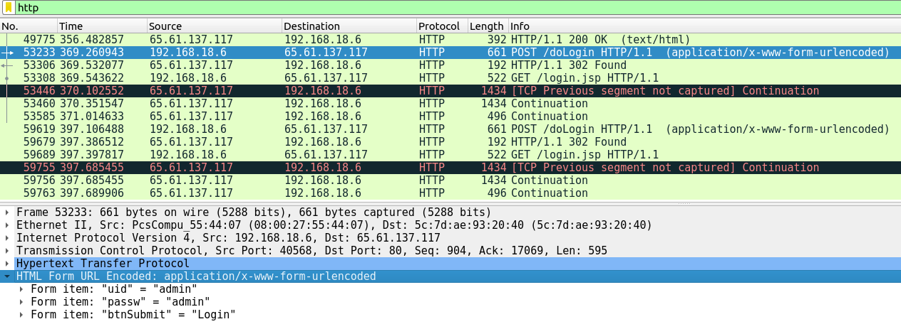
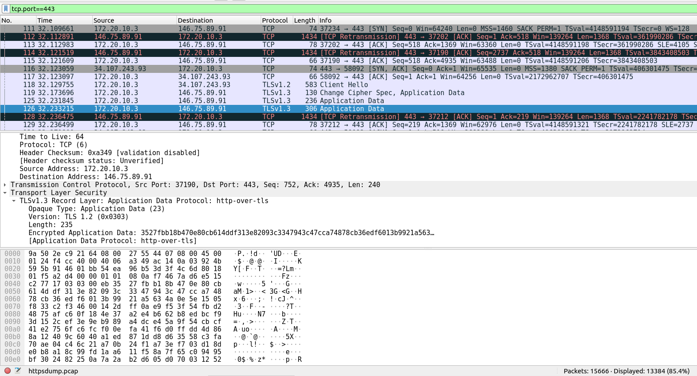

# Lab: Using Wireshark to Examine HTTP and HTTPS Traffic

Hands-on network traffic analysis lab from the Cisco Networking Academy CyberOps course. I use `tcpdump` to capture traffic and Wireshark to compare what an observer can see in plaintext HTTP versus encrypted HTTPS.

**Status:** Completed on 18th-october,2026. Both parts of the lab were done in the CyberOps Workstation VM, and the evidence is in the screenshots folder..

## Objectives

1. Capture and view HTTP traffic.
2. Capture and view HTTPS traffic.
3. Compare what is visible in each and explain the security difference.

## Environment

| Item | Detail |
|---|---|
| Virtual machine | CyberOps Workstation VM |
| Capture tool | `tcpdump` |
| Analysis tool | Wireshark |
| Browser | Browser inside the VM |
| Network | Internet connection |
| Capture interface | Recorded in `01-lab-documentation/OBSERVATIONS.md` (the lab example is `enp0s3`) |

## Method at a Glance

1. Identify the network interface (`ip address`).
2. Start `tcpdump` and write packets to a `.pcap` file.
3. Generate HTTP traffic, stop the capture, and open it in Wireshark.
4. Filter with `http` and inspect the POST request's form data.
5. Repeat the process for HTTPS and filter with `tcp.port==443`.
6. Inspect the TLS Application Data and compare the two captures.

## Results at a Glance

| HTTP (plaintext) | HTTPS (encrypted) |
|---|---|
|  |  |

In the HTTP capture, the login details I submitted were readable in the POST request. In the HTTPS capture, the application data was encrypted and unreadable.

## Skills Practised

- Capturing network traffic with `tcpdump` and saving it to `.pcap` files
- Opening and filtering captures in Wireshark (`http`, `tcp.port==443`)
- Inspecting an HTTP POST request and a TLS Application Data packet
- Comparing plaintext and encrypted traffic
- Documenting a lab with screenshots, notes and written findings

## Repository Structure

```text
wireshark-http-https-lab/
├── README.md
├── GITHUB-PUSH-GUIDE.md
├── 01-lab-documentation/
│   ├── LAB-GUIDE.md
│   └── OBSERVATIONS.md
├── 02-command-reference/
│   └── COMMANDS.md
├── 03-screenshots/
│   └── README.md
├── 04-pcap-analysis/
│   └── README.md
├── 05-findings/
│   ├── FINDINGS.md
│   └── HTTP-vs-HTTPS.md
├── 06-reflection/
│   └── REFLECTION.md
├── .gitignore
└── LICENSE
```

## Progress

- [ ] Part 1: HTTP capture completed
- [ ] Part 1: POST request inspected
- [ ] Part 2: HTTPS capture completed
- [ ] Part 2: Application Data inspected
- [ ] Screenshots added and checked for sensitive data
- [ ] Findings written
- [ ] Reflection answered

## Security Note

Packet captures can contain credentials, cookies, URLs and personal data. The `.gitignore` blocks `*.pcap` files, so captures stay on my machine. This repository publishes screenshots and written analysis only. The HTTP test uses the lab's public demonstration login on a deliberately insecure practice site, never a real account.

## Source

Based on the Cisco Networking Academy lab *Lab - Using Wireshark to Examine HTTP and HTTPS Traffic* (CyberOps). All lab content belongs to Cisco; the observations and analysis here are my own.

## Author

**Divine Kosisochukwu Obiorah**
GitHub: [DivineObiorah](https://github.com/DivineObiorah)
